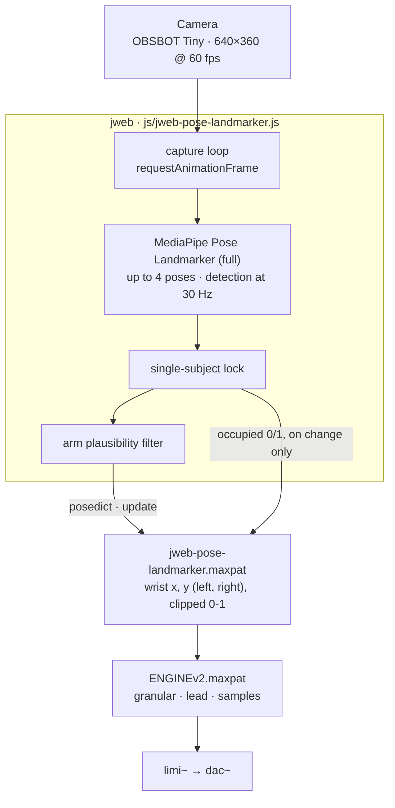
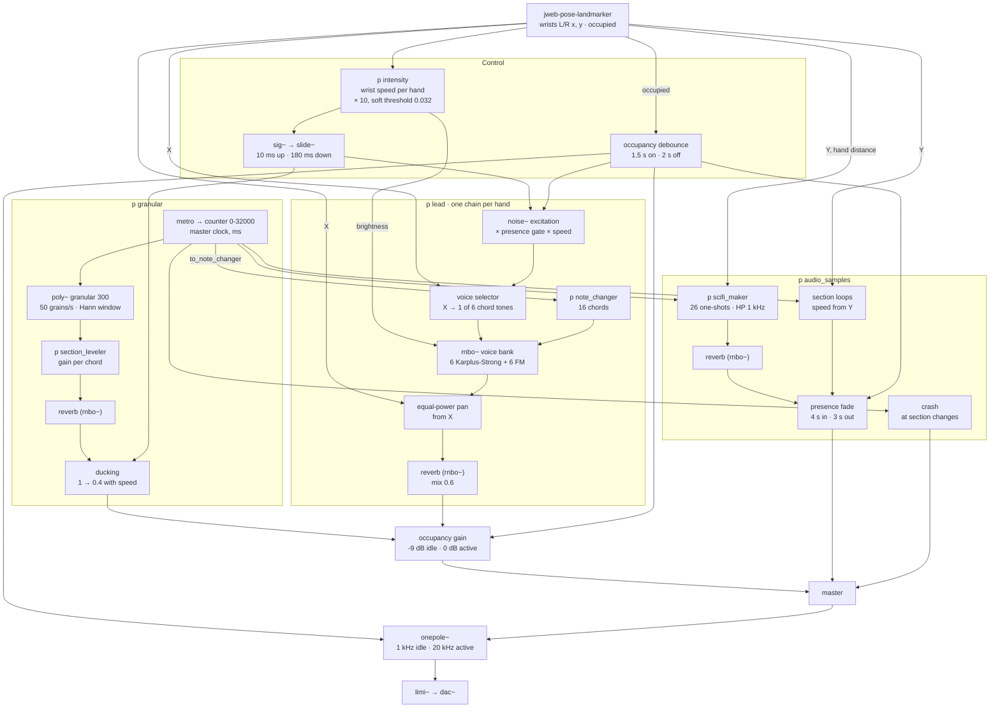

# *Ex Motu*

An interactive sound installation. A camera follows the visitor's hands and a Max/MSP engine turns their movement into sound. There is no gesture to learn: any movement, even a small one, changes what is heard. Pose tracking runs MediaPipe Pose Landmarker inside Max's `jweb` object, and the engine layers a granular texture, a waveguide/FM lead, sample loops and a probabilistic layer of one-shots.

[Matteo Caruso Linardon](https://carusolinardon.com): concept, sound design, DSP and tracking development. Presented to the public at Teatro Miela, Trieste, on 5 November 2026.

 

<!-- Video of the presentation: add the link and thumbnail here once it is published. -->

MediaPipe returns up to four skeletons per frame, in no fixed order and with no track ID, and its landmark model assumes a single body inside each crop. The installation faces a space where other people walk past behind the visitor. Most of the engineering therefore went into two questions: how to make the sound follow one person consistently, and what the sound should do when the tracker makes a mistake. The thresholds in the pipeline come from seven logged test sessions, about 23 minutes of tracking in total, from a single performer alone up to four people in frame.

## In brief

- The first user test, with four people of different ages and musical backgrounds, led to [a change of direction](#from-instrument-to-installation): the project moved from an instrument played with learned gestures to an installation that responds to any movement.
- In the multi-person test the detector often returned a single skeleton for several overlapping bodies, and the few identity switches that happened came from those merged skeletons. [The lock was redesigned around that](#what-the-multi-person-test-showed).
- With about three metres between the visitor and the people behind, an accomplice imitating the performer for 25 seconds caused [no holds and no anomalies](#distance-behind-the-visitor).
- The exhibition camera delivers frames in bursts. [Capturing at 60 fps and detecting at a fixed 30 Hz](#the-camera-delivers-frames-in-bursts) removed the resulting gaps in the control data.
- End-to-end latency, measured with 240 fps video, went [from about 333 ms to about 233 ms](#latency-measured-end-to-end). About 140 ms of the remainder is the camera's own path.
- The installation was [presented in public](#presented-in-public) for one day, and visitors responded very positively.

> **Scope.** A prototype built for a single exhibition day, with no budget beyond one consumer webcam, running on the author's own MacBook Pro. The tracking is calibrated for a visitor standing on a floor mark about 2 m from the camera, facing it. Audio assets are not included in the repository (see [Prerequisites](#prerequisites)).

## Design intent

Most everyday movements make some sound, and we rarely notice it. *Ex Motu* makes the link between a gesture and its sound audible again, in an unfamiliar form: when the visitor moves, the room responds. The aim was a sound suited to a science-fiction theme that still speaks to people with no background in electroacoustic music, children included, and a moment of surprise when they realise the sound is following them.

Accessibility shaped the sound. The harmony is tonal and recognisable, organised in four sonic environments that the piece moves through slowly, almost like places, from an open, floating Lydian colour to a whole-tone section that sounds the most alien. Alongside the synthesised layers there are familiar timbres (a heartbeat, percussion, a crash cymbal) and a layer of science-fiction one-shots that appears at random moments while someone is playing. There are no rules to learn and no wrong notes. Any gesture gives a coherent result, whether it comes from a musician or from someone moving their arms for the first time.

The project reached this form in stages. It started as an instrument: the visitor's wrist selected one of eight pitch zones along the horizontal axis, with an arpeggiator planned on top. The first user test (see [below](#from-instrument-to-installation)) showed that a mapping to be learned stood between the visitor and the surprise the piece was after, so the brief was rewritten. The installation should respond to *any* movement, including an uninhibited one, and translate it into a continuous sonic description.

There are no zones, since a visitor has no way of finding an invisible boundary. Movement drives the excitation, so sound grows as soon as the hand moves. Position shapes the colour: where the hands are decides which chord tone is excited, where the sound sits in the stereo field and how fast the loops run, so exploring the space sounds different from simply moving more. A quiet harmonic floor is always present. People passing by can hear the piece before they discover that it reacts, and the first gesture grows out of something already sounding.

The change also reset the priorities of the tracking. With the instrument, a wrong landmark meant a wrong note, so precision mattered most. With the installation, a brief glitch in limb attribution becomes a change of texture as long as the mapping is continuous, and the priorities become following one person and keeping the control signal smooth.

> **A design position.** No formal user study was run. The observations below come from logged test sessions and from one public day, during which no logs were recorded.

---

## Table of contents

- [Design intent](#design-intent)
- [System data flow](#system-data-flow)
- [Engineering the tracking](#engineering-the-tracking)
  - [From instrument to installation](#from-instrument-to-installation)
  - [Following one person](#following-one-person)
  - [What the multi-person test showed](#what-the-multi-person-test-showed)
  - [Arms that belong to someone else](#arms-that-belong-to-someone-else)
  - [Distance behind the visitor](#distance-behind-the-visitor)
  - [Calibrating the size band](#calibrating-the-size-band)
  - [The camera delivers frames in bursts](#the-camera-delivers-frames-in-bursts)
  - [Latency, measured end to end](#latency-measured-end-to-end)
  - [What it costs](#what-it-costs)
  - [How the numbers were taken](#how-the-numbers-were-taken)
- [Max/MSP patch](#maxmsp-patch)
  - [What was tried first](#what-was-tried-first)
  - [Gesture mapping](#gesture-mapping)
  - [Granular layer (harmonic floor)](#granular-layer-harmonic-floor)
  - [Four sonic environments](#four-sonic-environments)
  - [Lead (the hands' voice)](#lead-the-hands-voice)
  - [Sample layers](#sample-layers)
  - [Presence: waking the piece up](#presence-waking-the-piece-up)
- [Validation](#validation)
  - [The seven test sessions](#the-seven-test-sessions)
  - [Presented in public](#presented-in-public)
  - [Coverage, and where it is thin](#coverage-and-where-it-is-thin)
- [Known limits and scope](#known-limits-and-scope)
- [Prerequisites](#prerequisites)
- [Project structure](#project-structure)
- [Usage](#usage)
  - [Running the installation](#running-the-installation)
  - [Calibrating for a new room or camera](#calibrating-for-a-new-room-or-camera)
  - [Before an exhibition](#before-an-exhibition)
- [Tuning constants](#tuning-constants)
- [Troubleshooting](#troubleshooting)
- [Licensing](#licensing)
- [Credits](#credits)

---

## System data flow

The JavaScript side chooses which body to read and checks its arms. Max receives the same messages as in the original example (the `posedict` dictionary and an `update` message per frame), plus an `occupied` message sent only when the lock is gained or lost. Max handles timing and hysteresis on that signal in milliseconds, so they are independent of the frame rate.

---

## Engineering the tracking

### From instrument to installation

The first scripted session (test 003, 400 s, 11,964 frames) had four participants: two aged 22-27 and two aged 60, with one musician in each pair. They were given an explicit mapping to follow. Little melodic material came out of it, and the participant in their sixties without musical training kept moving freely after several minutes, which with the eight pitch zones produced a dense, chaotic result. Even with instructions the eight zones were hard to find, and an exhibition audience would have none. From that session on, the piece was developed as an installation.

### Following one person

The original example read `results.landmarks[0]`. That array has no fixed order, so with two people in frame the person behind index 0 can change from one frame to the next, and the wrist coordinates reaching Max can jump between two bodies.

The lock that replaced it works in four steps.

1. It asks for several poses. `NUM_POSES` is 4. With a single pose the model picks the subject by detector score; with several, the visitor stays in the array and the code can choose them.
2. It uses apparent torso size as a depth cue: the mean of the two crossed shoulder-hip diagonals, accepted within a plausibility band (85-380 px on a fixed 480 px vertical scale). The measure stays stable when the visitor raises their arms, which a bounding box would not. The landmarks' `z` field is relative to each body's own hip midpoint, so it cannot compare two people.
3. It follows the subject once chosen. Each frame the subject is re-associated to the nearest hip centroid within 0.65 torso lengths, provided its apparent size is consistent with a smoothed reference (factor 1.7). The size check separates two people standing closer than that radius when they differ in apparent size.
4. It makes handovers deliberate. A challenger has to stay between 1.25× and 2.2× larger for 25 consecutive detections, about 0.83 s, to take over. A subject that disappears is released after 15 missed detections, about 0.5 s.

During a hold the dictionary is left untouched and Max keeps the last value, so the sound stays on the visitor's last position for a moment. The lock adds no smoothing to the coordinates. The locked subject's responsiveness is unchanged, and the 0.83 s applies only to handovers.

### What the multi-person test showed

Test 003 put up to four people in frame, often about a metre behind the visitor, closer than an exhibition would normally allow.

In the two segments built around close-range interference, the model returned a single pose on 97% and 99% of frames while two to four people were in shot. Those segments also had the highest density of errors marked by the operator (15.0 and 7.8 per minute, against 0.9 with the visitor alone). BlazePose crops one detector region and regresses 33 points assuming one body inside it ([arXiv:2006.10204](https://arxiv.org/abs/2006.10204)), so overlapping bodies can come out as a single skeleton, and the selection logic then has only one candidate.

Five identity switches beyond the association gate occurred, landing on torsos of 274, 125, 222, 128 and 370 px against a typical value of 115. The five deliberate handovers marked during the session happened through lock loss and re-election, with no takeover. Since a larger torso reads as a closer person, a merged skeleton with an implausible size could win a takeover. The absolute size band and the scale-continuity test described above now keep such skeletons out of candidacy.

### Arms that belong to someone else

When a second person overlaps the visitor, the model can attach the other person's arm to the visitor's skeleton, and the lock has no way to see it from outside. Before writing a filter, a baseline take (test 004, 191 s) recorded the performer alone across the full range of distance and gesture: fast swings, full extension, arms pointed at the lens, stillness. It gave a reference for what a real arm does, from which the thresholds were set.

The filter checks two values per arm, both normalised by torso size: shoulder-to-wrist reach (cap 1.9 torso lengths) and wrist displacement per frame (cap 0.9 torso lengths). On rejection, the whole arm chain is held at its last accepted values and released after 15 frames, which avoids a stutter between held and fresh values when an arm stays unusual for a while. Replayed against the logs, it acts on 0.16% of the solo take and on 0.55% of the take with an accomplice trying to confuse the tracker (test 005).

In practice the velocity check does the work. The reach of the performer alone (up to 1.65) and with the accomplice (up to 1.70) were too close to separate, so the reach cap stays as a backstop. An arm attributed to the wrong person that still looks anatomically plausible passes the filter; three sessions confirmed this, and the staging handles it.

### Distance behind the visitor

Test 006 measured the effect of the distance between the visitor and the people behind them. An accomplice stood more than three metres behind the performer and imitated their gestures for 25 seconds. MediaPipe detected the accomplice in 311 of those 750 frames, and the lock stayed on the performer throughout: 0.00% holds, no geometric anomalies, no arm freezes.

At one metre the overlap problems of test 003 appeared; beyond three metres the tracking was stable even with someone deliberately imitating the visitor. For the exhibition this became a staging requirement of about three metres of clear space behind the floor mark. With any lens, it can be checked by size: a person at the closest position allowed to the public should read at most about 0.6 of the visitor's torso.

One idea was tested and set aside along the way. The asymmetry between the two torso diagonals was expected to grow on a skeleton merged from two bodies. In the data it tracked the distance from the lens (correlation 0.598 with torso size), which points to perspective. The value is still logged.

### Calibrating the size band

The size band needed two adjustments during development. A 240 px ceiling, taken from a session where the performer stayed in place, excluded the performer when they walked towards the lens (27.6% of the next solo take was spent holding). Later a 75 px floor excluded them when they stepped a few metres back, while MediaPipe was still detecting them. Since then both bounds are measured in the room where the piece runs.

The distance calibration (test 007, 468 s, 14,004 frames) gives the relation for an adult: `torso_px × distance ≈ 300 px·m` (198 px at 1.5 m, 150 at 2, 121 at 2.5, 103 at 3, 80 at 4). With the floor mark at 2 m, the floor is 85 px. It excludes adults beyond about 3.5 m and a piece of furniture that the model read as a skeleton in the empty room (63-77 px), and leaves margin for a smaller adult at the mark. A child of about two thirds of adult size would read around 98 px at 2 m (estimate).

### The camera delivers frames in bursts

With the exhibition camera (OBSBOT Tiny, first generation, USB 2.0) the tracking was audibly less fluid than with the built-in camera. Three changes, each following a measurement, fixed it.

1. An explicit capture format. Without constraints the browser chose 640×480, which on this camera is uncompressed YUY2 (about 147 Mbit/s, roughly three quarters of USB 2.0 isochronous bandwidth) and a 4:3 crop of the 16:9 sensor. Requesting a 16:9 format selects a compressed mode and the full sensor width.
2. Capture at 60, detect at 30. Frame timestamps logged outside Max showed that the camera delivers every frame, but sometimes two at once: 55-59 gaps of about 67 ms per minute at 1280×720/30, 116 per minute at 640×480, each followed by the next frame within 1 ms. A video element shows only the newest frame, so one frame of each pair was lost. At 60 fps the longest gap falls to 34 ms. Detection runs at 30 Hz on the newest frame, so a fresh frame is always available, the inference cost stays the same and the frame-counted constants keep their meaning. The page now runs its own capture loop; MediaPipe's `camera_utils` is no longer used.
3. 640×360. The model resizes its input to about 256 px anyway, so a smaller capture means less to encode, transfer and decode. The worst interval in the telemetry settled at 41.3 ms, one detection interval plus one 8.3 ms display tick.

Pixel thresholds refer to a fixed 480 px vertical scale derived from the source's real aspect ratio, so changing resolution or aspect ratio leaves them unchanged. A change of lens still requires recalibration.

### Latency, measured end to end

Latency was measured by filming the hand and the speaker together at 240 fps (about 4.17 ms per frame) and counting frames from the first visible movement to the sound.

| | measured |
| --- | --- |
| Original patch, hand to sound | 80 frames ≈ 333 ms |
| Current patch, hand to sound | 56 frames ≈ 233 ms |
| Hand to on-screen hand (OBSBOT) | 33 frames ≈ 138 ms |
| On-screen hand to sound | 18 frames ≈ 75 ms |
| Built-in MacBook camera, hand to sound | 48 frames ≈ 200 ms |

Each reading carries about ±4 frames of error. The 100 ms gained is consistent with the sum of the changes made, which had been estimated stage by stage beforehand:

- the wrist-speed difference is computed as each frame arrives, which removed a 50 ms `pipe` (about 17 ms);
- the two gains driven by the gesture are smoothed at signal rate (`sig~` → `slide~`, 10 ms up, 180 ms down), which removed a 33 ms control-rate `line` ramp (20-30 ms);
- the lead reverb runs at 60% wet, so note onsets reach the output through the dry path (with a fully wet reverb they waited 31-47 ms for the shortest comb filter);
- the granular ducking is applied after its reverb, so it follows the hand directly;
- data is sent to Max before the overlay is drawn, and capture runs at 60 fps.

About 140 ms of the remaining latency belongs to the camera: exposure, processing, compression, USB transfer and decoding. The built-in camera was about 33 ms faster but has no 60 fps mode, so the OBSBOT stayed as the exhibition camera.

### What it costs

Measured on a MacBook Pro (M4 Pro, 14-core CPU, 20-core GPU), `pose_landmarker_full`, four poses requested, capture at 640×360/60, detection at 30 Hz (test 007):

| | measured |
| --- | --- |
| `detectForVideo` time, median | 13.2 ms |
| 95th percentile | 18.2 ms |
| Maximum | 37.9 ms |
| Share of the 33.3 ms detection budget | 36.8% |
| Detection interval, median / p95 / p99 | 33.3 / 34.2 / 34.3 ms |

`detect_ms` is the time the JavaScript call blocks, which is what competes with the frame budget; the GPU work behind it may still be running when the call returns. In the first sessions each additional pose in frame cost about 5 ms over the single-pose time, while the third and fourth added very little, which suggests that the detector stage dominates (inference). Running on battery made no measurable difference in one-minute takes. A three-hour run on battery was never tested.

During the installation, Max's CPU meter read about 6%, with Max running at 44.1 kHz, an I/O and signal vector of 32 samples and Overdrive on.

### How the numbers were taken

The page cannot write to disk, so during development it posts batched samples once a second to a small Node server on `127.0.0.1:8787`. The server writes one CSV per take with per-frame timing, pose count, locked subject, hip position, torso size, reach and velocity of each arm, and the power state sampled every 10 s. Keys pressed in the server's terminal add markers to the file for a phase change, an observed error and a voluntary handover. Each marker carries its own time window: an error is noticed a moment after it starts, while a new phase settles a moment after it is called. If the server does not answer at startup, the client turns itself off for the rest of the session, so it can stay in place during an exhibition.

The log server and the seven CSV files are kept locally and are not part of this repository. The figures in this section are measurements; the perceptual judgements in the next one are the author's, and are marked as such.

---

## Max/MSP patch

`ENGINEv2.maxpat` holds the whole engine. Its top level contains the tracking abstraction, the control logic and the output stage, and the sound is produced in five subpatchers: `p intensity`, `p granular`, `p lead`, `p audio_samples` and `p section_leveler`.

Each layer also has a volume slider before the stage that follows it, left out of the diagram for readability. A single counter, the read position of the granular buffer in milliseconds, works as the clock of the whole piece: it sets the chord of the lead, the gain of each chord, which loop is playing, when the crash plays and when the sci-fi layer can sound.

> **On the perceptual language below.** Words like *ethereal*, *heavy* and *uncanny* describe what each choice is meant to evoke, judged by ear by the author. They are design intentions and were not tested with listeners.

### What was tried first

An instrument with pitch zones: eight zones on the horizontal axis, with a planned arpeggiator, set aside after test 003 (see [above](#from-instrument-to-installation)).

Physical modelling as the main voice. The first engine was built on waveguide and FM voices. For the main layer of this piece they had a drawback: each note is a separately tuned resonator, so moving between notes means changing which resonator is excited, which fits poorly with a continuous space without zones. Granular synthesis took over the floor because its parameters are continuous and any combination of values gives a usable texture. The waveguide and FM voices were kept as the lead. CPU was never a constraint on the target machine.

A truncated Gaussian grain window. At its edges it still stood at 4.4% of the peak, so every grain started and ended with a small step, a hundred times a second. A simulation of the engine put the resulting broadband noise 53 dB below the signal at low frequency and 61-68 dB below it above 1.5 kHz. It had never been heard on reference headphones, but the venue's sound system was unknown, so as a precaution the window was replaced with a Hann window of nearly the same effective length.

A lead that started at 20 Hz. For the first 21 seconds after loading, the lead sounded like a very slack string. No note had arrived yet, so each voice sat at its 20 Hz frequency floor, where a Karplus-Strong loop is about 2,400 samples long and each pass is heard as a separate click. RNBO's `[change]` starts from 0 and was discarding the first chord index, which is also 0. The chord selector now starts from -1, so the first chord is sent at load and after each recompile.

### Gesture mapping

| Gesture feature | Destination |
| --- | --- |
| Wrist speed, per hand | excitation level of that hand's lead (log taper), granular ducking (gain 1 → 0.4), lead brightness |
| Horizontal position, per hand | which of the six chord tones that hand excites; that hand's stereo position |
| Height of the higher hand | playback speed of the current section loop and of the sci-fi one-shots |
| Distance between the hands | tick rate of the sci-fi one-shot clock (100-200 ms) |
| A visitor locked for 1.5 s | wakes the piece (see [Presence](#presence-waking-the-piece-up)) |

Wrist speed is the larger of the x and y displacements between consecutive detections, multiplied by 10 and clipped to 0-1. A soft threshold subtracts 0.032 and rescales the rest, so a hand held still gives zero and the curve stays continuous above the threshold. The value matches the median jitter of a still hand measured at 2 m in test 007 (0.016 at the earlier gain of 5).

The two signal-rate gains rise quickly and fall slowly. The 10 ms attack keeps the sound tied to the start of the movement. The 180 ms release smooths frame-to-frame flicker and covers the tracking holds (130-330 ms), during which the coordinates are frozen and the speed would otherwise drop to zero.

### Granular layer (harmonic floor)

`p granular` launches one grain every 20 ms (50 per second) into a `poly~` of 300 voices. Each grain lasts 300-320 ms, starts at a random point within 50 ms of the read position, plays at the original speed and is shaped by a 512-point Hann window, so about fifteen grains overlap at any moment. The source is a 32-second file in four sections of 8 s, one per sonic environment, each a progression of four 2-second chords.

The read position advances by 1 ms every 20 ms, a twentyfold time stretch: one chord lasts 40 s, one section 2 min 40 s, a full pass through the file 10 min 40 s, after which it loops. At that speed the progression is heard as a slow movement through harmonic space, and what reaches the listener is mostly the pitch content around the read position, its register and its spectrum (by ear). Level changes in the file are stretched twentyfold as well, so `p section_leveler` trims each of the 16 chords with its own gain, ramped over one second, to keep the floor even across the four environments.

The granular layer follows the gesture through the ducking: as the hands move faster it drops towards 0.4, which leaves room for the lead.

### Four sonic environments

The four sections differ along properties that remain audible after granular smearing: whether the root is in the bass, register, mode, and the interval content of the whole collection.

| Section | Chords | Intended character | How |
| --- | --- | --- | --- |
| 1 (0-8 s) | Ab/C, Cm, Eb/Bb, Bb | ethereal, free | Ab Lydian; the bass avoids the tonic; close voicing within one octave; no leading tone |
| 2 (8-16 s) | Bbm, Fm, Db, Eb | dark, heavy | F minor; root, fifth and tenth in open position, moving in parallel, roots in octaves 1-2 |
| 3 (16-24 s) | Ebsus2, Cm7/Eb, Bbsus2, Fsus2 | crystalline, open | the whole collection is the Eb major pentatonic, with no semitones; third-less chords in octaves 5-6 |
| 4 (24-32 s) | C7b5, E7b5, D7b5, Caug | suspended, uncanny | all four chords inside one whole-tone collection, with no semitone, perfect fifth or tonic |

Section 1 was written first, and each of the others changes some of its properties. The joins between sections move as few voices as possible. From section 1 to 2 the mode darkens by one semitone (D to Db), and the loop from section 4 back to 1 resolves the whole-tone chord into the first chord with a single semitone (E to D#). The fourth environment also connects to the science-fiction theme the piece was made for.

### Lead (the hands' voice)

Each hand has its own lead chain, built around a `rnbo~` voice bank of twelve voices: six Karplus-Strong waveguides and six four-operator FM pads, one of each per chord tone. `p note_changer` follows the master clock through 16 chord boundaries measured by hand against the file and sends the current chord as a triad plus the same triad an octave higher. All chords sit in one register (about 207-932 Hz), since the granular layer carries the register changes between environments. The voicings keep voice motion small, including across the joins between sections.

The excitation is noise, gated by presence and scaled by the hand's speed through a log taper. The hand's horizontal position chooses which of the six tones receives it, with an equal-power crossfade of about 106 ms, so moving the hand across the space walks through the chord. The same position pans that hand's lead (equal-power law, 20 ms smoothing), and the two chains share a Schroeder-Moorer reverb at 60% wet.

### Sample layers

`p audio_samples` contains three kinds of material.

- Section loops: one `groove~` loop per environment (alien, heartbeat, triangle, percussion), playing while the clock is inside its section. The higher of the two hands sets the playback speed, within a range chosen for each loop.
- Crash: a crash cymbal sample plays at each section change. It bypasses the presence fade on purpose. With nobody at the installation the rest of the mix sits back as an ambient texture, and an occasional louder event makes the piece noticeable. During the presentation people often turned towards it and came closer.
- Sci-fi one-shots: `p scifi_maker` picks one of 26 samples at random on about one tick in ten of a clock whose period (100-200 ms) follows the distance between the hands, with the playback speed set by hand height. It stays silent in section 2, the heavy environment. Its output is high-passed at 1 kHz and has its own reverb.

The loops and the one-shots fade in and out with presence on an exponential curve (4 s in, 3 s out) and join the mix at the master stage.

### Presence: waking the piece up

The Pose Landmarker returns no per-pose presence score, and counting detected poses would mark the installation as in use whenever someone walked behind the visitor (in test 006 a bystander at three metres was detected in 311 of 750 frames). The presence signal is the lock itself: the installation is occupied while a subject is locked, including short holds.

In Max a single `delay`, restarted by each change, debounces it: the state has to hold for 1.5 s to become active and for 2 s to become idle. A brief lock on a passer-by does not wake the piece, and the gap of a handover between two visitors is covered. When the piece wakes up:

- the granular and lead mix rises from -9 dB to 0 dB over 1.5 s (2 s on the way down), interpolated in dB at signal rate to avoid zipper noise and to follow perceived loudness more closely;
- the lead's excitation gate opens in 20 ms (and closes in 200 ms);
- the loops and one-shots fade in;
- a one-pole low-pass on the whole output opens from 1 kHz to 20 kHz over 4 s (and closes over 3 s).

At rest the granular floor remains, darker and quieter, together with the crash at section changes. The trade-off is that a new visitor's first gestures are slightly attenuated, and the lead starts after 1.5 seconds.

The output stage is `limi~` with a -1 dB threshold and no pre-gain, which keeps the level difference between rest and activity and the contrast between the floor and the gesture layers.

---

## Validation

### The seven test sessions

Each session was logged to CSV and analysed offline. Session 007 was the first recorded with the exhibition camera.

| Test | Date | Length | People | Question | What changed |
| --- | --- | --- | --- | --- | --- |
| 001, 002 | 24 Aug 2026 | 48 s, 62 s | 1-2 | baseline cost; effect of battery | miss tolerance 10 → 15 detections (three holds per take recovered on the 10th) |
| 003 | 25 Aug | 400 s | 4 | scripted multi-person session | move to an installation; size band; scale continuity; 4 poses |
| 004 | 26 Aug | 191 s | 1 | the performer's own range of movement | size ceiling 240 → 380 px; arm filter thresholds |
| 005 | 26 Aug | 135 s | 2 | an accomplice trying to confuse the tracker | arm filter checked (0.55% vs 0.16%) |
| 006 | 26 Aug | 81 s | 2 | effect of distance behind the visitor | 3 m clearance; floor 75 → 60 px; takeover cap 2.2× |
| 007 | 4 Nov | 468 s | 2 | distance calibration, exhibition camera | floor 60 → 85 px; window focus requirement (below) |

Test 005 has no markers, since the screen recording failed and no key was pressed. Its phases were reconstructed from the data: a quiet opening while the accomplice walked behind, velocity spikes during the imitation, more holds during the approach, and one 1.9 s episode combining a hip jump, a size jump and a velocity spike during the handover. They matched the operator's account, so offline analysis became a workable alternative to live marking.

Test 007 also found eight pauses of 1.9-12.6 s in which detection stopped, five of them within three seconds of a marker, when the operator was at the laptop. The embedded browser slows `requestAnimationFrame` when the Max window loses focus, and switching to another application stops the frames, as the author confirmed. Max keeps the last values, so the sound is unaffected while the image freezes. For an exhibition, the jweb window stays in front and visible, with display sleep, screensaver and Low Power Mode off.

### Presented in public

*Ex Motu* was presented at Teatro Miela in Trieste on 5 November 2026, as part of the conservatory's exhibition of student work, and visitors were free to try it. The exhibition lasted one day. The author stayed in the room throughout to answer visitors' questions, so the installation ran on the author's own MacBook Pro.

Visitors who tried it responded very positively and showed strong interest. The system worked as expected throughout, with no issues beyond those already known. No log was recorded on the day, so what follows is the author's account.

Many visitors explored the installation more freely than the setup anticipated. They moved closer to the camera, used the space in depth as well as side to side, and tried interacting with the camera itself in their own ways. The tracking was set up for a visitor about 2 m away and facing the camera. By the test 007 calibration, a visitor at 1 m reads about 300 px and one at 0.8 m about 375 px, close to the top of the size band, while beyond about 3.5 m the torso falls below the floor.

The 2 m setup reflects the conditions of the project: a budget limited to one webcam and a short development time.

### Coverage, and where it is thin

- One public day, without data. The presentation produced observations and first-hand impressions, with no questionnaire or task.
- One room, one lens. Thresholds were calibrated in the author's own spaces. Strong backlight and moving stage lighting were never tested, and capturing at 60 fps limits exposure to 1/60 s, which has not been checked in low light.
- Few bodies at realistic distance. Only test 003 had more than two people, at a deliberately short distance. Four people in frame at a realistic distance remains untested.
- Children. The 85 px floor leaves room for a child at the mark based on an estimate; no child took part in the tests.
- Plausible misattribution of an arm passes the filter, as described above.
- Perceptual choices were made by ear, by one listener, on reference headphones.

---

## Known limits and scope

Most of these are deliberate choices, given the budget and the development time available.

- The geometry is part of the setup. The tracking expects a visitor at about 2 m, roughly frontal, with clear space behind. At the presentation many visitors explored beyond that.
- Plausible limb swaps. When two bodies are at a similar distance, a borrowed arm can look anatomically correct. The staging answer is about three metres between the visitor and the nearest person behind them.
- The first 1.5 s of a visit. The debounce that keeps passers-by from waking the piece also delays a real visitor slightly. A shorter debounce would respond sooner and wake more often by mistake.
- The jweb window needs focus. If it loses focus, detection stops. This depends on the embedded browser.
- A network connection at startup. MediaPipe Tasks Vision is loaded from jsDelivr and the model from Google's storage at runtime.
- Frame-counted constants assume 30 Hz detection. A different detection rate changes each hysteresis time and the velocity threshold in real terms.

---

## Prerequisites

- Max 9 (the patches were saved with 9.0.7) with RNBO: the lead and the reverbs are `rnbo~` objects.
- macOS. Developed and run on a MacBook Pro M4 Pro; other platforms are untested.
- A webcam. The exhibition used an OBSBOT Tiny (first generation); the built-in MacBook camera works as a fallback.
- A network connection at startup, for MediaPipe and the model.
- Audio assets. They are not distributed with this repository, since several of them are third-party samples licensed for use within the work only. The patch expects `audio/granularv6.wav` (the granular source, 33 s), `audio/samples/` (`alien`, `heartbeat`, `triangle`, `perc`, `crash`) and `audio/scifimaker/scifi0.wav` to `scifi25.wav`; any WAV files with the same names will load. Without them the patch opens and tracks, and only the lead sounds. The video linked at the top shows the installation with its original sounds.

## Project structure

- `ENGINEv2.maxpat`: the audio engine. Embeds the tracking abstraction and contains each layer described above.
- `granular.maxpat`: the grain voice used by `poly~` in `p granular`.
- `jweb-pose-landmarker.maxpat`: the tracking abstraction. Hosts `jweb` and the camera menu, and unpacks the left and right wrist x/y and the `occupied` message.
- `jweb-pose-landmarker.html`, `js/jweb-pose-landmarker.js`, `js/pose-landmarks-index.js`, `css/mesh-style.css`: the page loaded by `jweb`. The JavaScript file contains the capture loop, the single-subject lock, the arm filter, the telemetry overlay and the optional log client.
- `LICENSE`, `LICENSE-CC-BY-NC-SA.md`, `NOTICE.md`: see [Licensing](#licensing).

## Usage

### Running the installation

1. Put the audio assets in `audio/` as listed in [Prerequisites](#prerequisites).
2. Open `ENGINEv2.maxpat` and turn audio on.
3. The camera opens automatically. The page looks for an OBSBOT Tiny first, then for the built-in MacBook camera, and skips iPhones, iPads and virtual cameras at startup (they can still be chosen from the menu). "OBSBOT Virtual Camera" is the vendor software's output; choose the camera itself.
4. Stand at about 2 m, facing the camera. After 1.5 s the piece wakes up.

The overlay shows a telemetry readout: the capture format actually delivered, detection time, frame interval, worst interval over the last two seconds, pose count, arm filter state and the locked subject (or `HOLD`). If `detect_ms` approaches the interval, the model is too heavy for the machine. If `detect_ms` stays low while the interval grows, the capture loop is being slowed down, which on a laptop usually means battery power or a window out of focus.

### Calibrating for a new room or camera

Only the absolute pixel bounds depend on the lens; the other values are ratios or are normalised by torso size.

1. Place the floor mark and record a short take with the visitor in position and nobody else in frame. Read the torso size from the telemetry.
2. Set `SUBJECT_MIN_TORSO_PX` to about 0.7 of that value, or lower if children should be tracked at the mark. For an adult, `torso_px × distance ≈ 300 px·m` with the lens used here.
3. Repeat with a person at the closest position allowed to the public. Their torso should read at most about 0.6 of the visitor's; if it reads more, move the barrier back.
4. Check the telemetry: the `camera` line should show the requested format, and the worst interval should stay around 34-42 ms.

### Before an exhibition

- `showTelemetry = false` in `js/jweb-pose-landmarker.js`; image and skeleton drawing off in the jweb patch.
- OBSBOT Center: both gesture controls off (on the first-generation model an open hand near the face locks or unlocks tracking, and another gesture toggles the 2× zoom, both easy to trigger by accident); AI tracking off; zoom 1×; a fixed gimbal start position; anti-flicker set to the local mains frequency. Close the Center window during the show and check that the settings survive unplugging the camera.
- Laptop on mains, with display sleep, screensaver and Low Power Mode off, and the Max window in front.
- Wired speakers close to the visitor. Bluetooth typically adds 100-250 ms.
- About three metres of clear space behind the floor mark.

## Tuning constants

All in `js/jweb-pose-landmarker.js`. The last column says whether a value survives a change of room or lens.

| Constant | Value | What it does | Survives a geometry change? |
| --- | --- | --- | --- |
| `NUM_POSES` | 4 | poses requested from the detector | yes; re-check `detect_ms` |
| `SUBJECT_MIN_TORSO_PX` | 85 | floor of the size band, applied every frame | no, set for a 2 m mark |
| `SUBJECT_MAX_TORSO_PX` | 380 | ceiling of the size band | no, scales with focal length |
| `SUBJECT_GATE_TORSO` | 0.65 | association radius, in torso lengths | yes |
| `SUBJECT_SCALE_JUMP_MAX` | 1.7 | largest accepted change in apparent size | yes |
| `SUBJECT_TAKEOVER_RATIO` / `_MAX` | 1.25 / 2.2 | size range a challenger must fall in | yes |
| `SUBJECT_TAKEOVER_FRAMES` | 25 | sustained challenge before a handover (0.83 s) | depends on detection rate |
| `SUBJECT_MAX_MISS` | 15 | tolerated dropout before release (0.5 s) | depends on detection rate |
| `ARM_REACH_MAX` | 1.9 | shoulder-to-wrist cap in torso lengths, kept as a backstop | yes |
| `ARM_WRIST_VEL_MAX` | 0.9 | wrist displacement cap per frame, in torso lengths | depends on detection rate |
| `ARM_FREEZE_MAX_FRAMES` | 15 | longest hold of a rejected arm (0.5 s) | depends on detection rate |
| `CAPTURE_WIDTH` × `CAPTURE_HEIGHT` @ `CAPTURE_FPS` | 640 × 360 @ 60 | capture format requested | yes |
| `DETECT_INTERVAL_MS` | 33.3 | detection at most at 30 Hz, on the newest frame | reference clock for the frame-counted values |
| `METRIC_HEIGHT` | 480 | vertical scale of all pixel thresholds | fixed by definition |
| `showTelemetry` | true | development readout | set to `false` for a show |

In Max, the wrist-speed gain (10) and soft threshold (0.032) are set by `loadmess` at the top level of `ENGINEv2.maxpat`.

## Troubleshooting

### The image freezes and the sound stops reacting

The Max window lost focus or was hidden, and the embedded browser paused the capture loop. Bring Max to the front. During a show, keep other applications closed.

### The sound follows someone walking behind the visitor

The floor of the size band is too low for the room. Recalibrate `SUBJECT_MIN_TORSO_PX` as described above and check the space behind the mark.

### The lead is silent for the first second or two

This is expected: the piece waits for 1.5 s of stable presence before opening the lead.

### The tracking drops when the visitor is very close or very far

The visitor is outside the size band set for about 2 m. MediaPipe is still detecting them, and the lock releases them by design.

### At startup the page asks for confirmation on an iPhone

An earlier version picked the best-matching camera, which could be an iPhone through Continuity Camera. The current code chooses the camera by name; check that your camera's label matches an entry in `STARTUP_CAMERAS`.

## Licensing

This repository contains files under two licenses.

| Files | License | Origin |
| --- | --- | --- |
| `js/jweb-pose-landmarker.js`, `jweb-pose-landmarker.maxpat` | GPL v3 ([`LICENSE`](LICENSE)) | modified from [lysdexic-audio/jweb-pose-landmarker](https://github.com/lysdexic-audio/jweb-pose-landmarker); changes listed in [`NOTICE.md`](NOTICE.md) |
| `jweb-pose-landmarker.html`, `js/pose-landmarks-index.js`, `css/mesh-style.css` | GPL v3 ([`LICENSE`](LICENSE)) | unmodified from the same project |
| `ENGINEv2.maxpat` (including the RNBO and gen~ code inside it), `granular.maxpat` | CC BY-NC-SA 4.0 ([`LICENSE-CC-BY-NC-SA.md`](LICENSE-CC-BY-NC-SA.md)) | original work |
| This README, documentation and images | CC BY-NC-SA 4.0 | original work |

`ENGINEv2.maxpat` loads the GPL tracking abstraction at runtime. How the GPL applies to a Max patch and an abstraction it loads is an open question; this split reflects the author's reading and is not legal advice. If you redistribute the engine together with the tracking module, the cautious approach is to treat the combination as covered by the GPL.

The audio files and the presentation video are not covered by either license. Several of the sounds are third-party samples licensed for use within the work only; the video is shared for viewing, with all rights reserved.

MediaPipe Tasks Vision (`@mediapipe/tasks-vision`) and the Pose Landmarker model are loaded from the network at runtime and are not redistributed here. The pose model is released by Google under the Apache License 2.0, according to its [model card](https://storage.googleapis.com/mediapipe-assets/Model%20Card%20BlazePose%20GHUM%203D.pdf).

## Credits

The tracking page and abstraction started from [jweb-pose-landmarker by lysdexic-audio](https://github.com/lysdexic-audio/jweb-pose-landmarker), which was inspired by [an example by Rob Ramirez](https://github.com/robtherich/jweb-mediapipe), in turn inspired by [MediaPipe in JavaScript](https://github.com/LintangWisesa/MediaPipe-in-JavaScript). Pose estimation: MediaPipe Pose Landmarker, based on BlazePose (Bazarevsky et al., [arXiv:2006.10204](https://arxiv.org/abs/2006.10204)).

Thanks to the people who took part in the test sessions.
